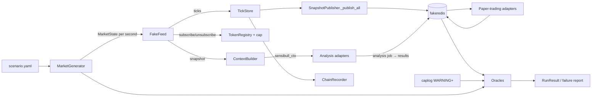

# E2E market-simulation design (T5)

Status: **implemented (T5.1–T5.9; T5.10 replay pending capture data)** · 2026-11-23
Code: `tests/e2e/sim/` · scenarios: `tests/e2e/scenarios/` ·
run: `make test-e2e` (8 scenarios, ~20 s) · 50 E2E tests in total.
Nightly runs three seeds per scenario (`E2E_MULTI_SEED=1`).
Parent plan: `docs/testing-strategy.md` §8 (T5) · Cadences verified from source.

---

## 1. Purpose

Run a complete trading day in-process, in seconds, through the **real** service
code, and assert outcomes. It is the only layer that can catch cross-service,
time-dependent bugs. Each of these production incidents would have failed it:

| Incident (Nov 2026) | Scenario that catches it | Oracle |
|---|---|---|
| WS2 held 542 subscriptions vs Kite's 500 cap | `trend_day_up` | `subs_within_cap` |
| data-gateway heartbeat TTL 120 s < 310 s cycle | any scenario > 10 min | `heartbeats_present` |
| Orchestrator heartbeat `time.time()` TypeError | any scenario | `no_errors` |
| `open_oi` baseline lost on restart | `restart_midday` | `exits_valid` + documented delta |
| Entry after 14:00 on expiry day | `expiry_day` | `entry_gates` |
| Signal/trade field drift | any scenario with an entry | `pnl_reconciles` |

## 2. Non-goals

- Not a performance benchmark (that is T7) and not a broker/API test.
- Does not start systemd units, threads, or real Redis. In-process, deterministic.
- Does not validate wording of alerts (unit/formatter tests own that).

## 3. Architecture



One simulated second = one pass of the scheduler in §5. No threads. The clock is
moved, never read.

## 4. Determinism contract

1. Clock: `time_machine.travel(start, tick=False)`; the harness calls
   `clock.move_to(t)` before each step. Service code must never call
   `datetime.now()` for decisions we assert — where it does, the harness pins it
   via the same travel.
2. Randomness: one `numpy.random.Generator(seed)` owned by the harness, passed to
   the generator. Hypothesis seeds are recorded in the failure report.
3. No network: `market_calendar.is_trading_day` is patched from the scenario
   (`trading_days`), as are Telegram notifications and Sensibull/Kite clients.
4. Redis: `fakeredis` behind the production `RedisProxy` (`fake_redis` fixture).
5. Ordering inside a second is fixed and documented (§5); scenario files must not
   depend on it.

## 5. Scheduler (real cadences)

Verified from source: `SnapshotPublisher.INTERVAL=1`, paper
`MTM_CYCLE_SECONDS=3`, `chain_recorder` futures 1 s / chain 30 s / index 10 s /
flush 300 s, volatility `INFERENCE_INTERVAL_SECONDS=3`, data-gateway
`CYCLE_SLEEP=310`, `HEARTBEAT_INTERVAL=60`.

Fixed order within each simulated second `t`:

| Every | Step |
|---|---|
| 1 s | `feed.push(market.step(1))` → TickStore updates; registry recentre; ticks for subscribed strikes only |
| 1 s | `publisher._publish_all()` |
| 1 s | `recorder._capture_futures(t)` |
| 1 s | paper-trading `mtm_once(redis, t)` |
| 3 s | vol-engine `_run_inference_iteration(redis, model_manager, t)` |
| 10 s | `recorder._capture_index(t)` |
| 30 s | `recorder._capture_chain(t)` |
| 60 s | heartbeat writers for every service |
| 300 s | `recorder._flush_all()` |
| 310 s | analysis cycle: build ctx → `process_job()` per index → analysis results to Redis → `process_analysis_message()` / `handle_signal()` → `strategy_step()` |

Scenario may override any cadence with `cadence: {step_seconds: 5|1}`; the fast
profile is 5 s steps with the 310 s cycle compressed to 30 simulated seconds
(`time_compression: 10`), used in PR runs.

Session window: 09:15–15:30 IST, `end - start` in seconds; non-trading days are
short-circuited by patching `is_trading_day`.

## 6. Components

### 6.1 Scenario (`tests/e2e/scenarios/*.yaml`)

```yaml
name: trend_day_up
description: One-directional rally that forces chain re-centring past the WS cap.
date: 2026-11-24
seed: 7
symbols: [NIFTY, BANKNIFTY, SENSEX]
start: "09:15"
end: "15:30"
cadence: {step_seconds: 1}
spot: {NIFTY: 25500, BANKNIFTY: 63300, SENSEX: 83200}
strike_gap: {NIFTY: 50, BANKNIFTY: 100, SENSEX: 100}
drift_pct_per_day: 2.0        # realised over the session
vol_annual: 0.14
gap_pct: 0.0
vix: {start: 14.0, end: 17.0}
iv_smile: {atm: 0.13, skew: -0.08, smile: 0.40}
oi_flow: {ce_writing_pct_per_min: 0.01, pe_writing_pct_per_min: 0.03}
expiry: {NIFTY: 2026-11-25, BANKNIFTY: 2026-11-25, SENSEX: 2026-11-27}
faults: []
oracles: [no_errors, subs_within_cap, chain_follows_spot, capture_coverage,
          entry_gates, exits_valid, pnl_reconciles, risk_limits, heartbeats_present]
```

Validation (fail fast, schema errors must name the key): symbols ⊆ configured
live set, start < end, expiry ≥ date, unknown oracle/fault rejected.

### 6.2 MarketGenerator (`tests/e2e/sim/market.py`)

```python
@dataclass(frozen=True)
class MarketState:
    t: datetime; spot: dict[str, float]; fut: dict[str, float]
    vix: float; atm_iv: dict[str, float]

class MarketGenerator:
    def __init__(self, scenario: Scenario, rng: np.random.Generator): ...
    def step(self, dt_seconds: int) -> MarketState: ...
    def chain(self, state, strikes, expiry) -> dict[float, dict[str, dict]]: ...
```

- Spot: GBM with `sigma = vol_annual/sqrt(252*375)` per minute, drift scaled to
  the session; optional jump schedule; opening gap applied at 09:15.
- IV: `atm_iv(t)` interpolated start→end; smile `atm + skew*k + smile*k²`,
  `k = ln(K/F)`; per-strike IV clamped to ≥ 1 %.
- Option price: **reuse** `tools/pinn_volatility/model/bs_utils.py` (do not write
  a second Black-Scholes).
- Tick: `ltp`, `bid = ltp*(1-s/2)`, `ask = ltp*(1+s/2)`, `s = 0.2 %`,
  5-level depth around the mid, `volume` increasing, `oi` from the OI model.
- OI model: base OI decays `exp(-|k|/0.02)` from ATM per side; per-minute writing
  from `oi_flow` applied to the nearest 5 strikes per side; `open_oi` frozen at
  the first tick of the session per (strike, side) and restored on restart
  scenarios exactly as production does (`TickStore.open_oi`).
- Futures: `fut = spot * (1 + carry)`, `carry` from `basis_pct` (default 0.15 %),
  volume/oi follow the same writing model.

### 6.3 FakeFeed (`tests/e2e/sim/feed.py`)

- Holds one real `TickStore` per symbol (inside the real `Stock`/`StockProxy`).
- Calls `update_zerodha_data`, `update_option_tick(strike, side, tick)`,
  `update_futures_tick("current", tick)`, `set_options_expiry`,
  `recompute_options_aggregate(spot)`.
- Owns a real `TokenRegistry`; per second calls
  `recenter_and_get_subscription_changes()`; **enforces the broker limit**:
  any subscribe that would exceed `WS_MAX_OPTION_SUBSCRIPTIONS` records
  `SubscribeRejected(token, count)` and raises in strict mode; only subscribed
  strikes receive ticks (so a missing subscription starves the aggregate, like production).
- Exposes `subscribed_count`, `rejected`, `atm_subscribed(symbol)`.

### 6.4 ContextBuilder (`tests/e2e/sim/context.py`)

Builds the `sensibull_ctx` the analysers expect **from the same chain state** the
feed emitted, so the two never disagree:

```python
def build(stock, state, registry) -> dict:
    # {"current": {"stats": {"per_expiry_map": {...},
    #                        "underlying_base_stats": {...}}},
    #  "oi_chain": {per_strike_data, prev_ltp, current_ltp, pcr, ...},
    #  "oi_chain_history": [...], "oi_history": DataFrame, "iv_chart_history": DataFrame}
```

Max pain via `sensibull_fetcher._compute_max_pain`, PCR from totals, IV
percentile via `_compute_iv_percentile` — reuse the production functions.

### 6.5 Service adapters (`tests/e2e/sim/harness.py`)

The harness calls extracted one-step functions (§7), with these stand-ins:

| Production dependency | Harness value |
|---|---|
| `TELEGRAM_NOTIFICATIONS` | recorder stub capturing (symbol, key, sentiment) |
| `ledger` SQLite | `tmp_path/paper_trades.db` via `ledger.DB_PATH` |
| `is_trading_day` | scenario dates |
| `model_manager` | `None` (no-op) unless scenario sets `model: fixtures/pinn_v1` |
| Kite/Sensibull clients | never constructed (feed/context supply data) |

`RunResult` : positions, trades (from SQLite + stream), analysis events,
entries/exits, subscription trace (max, rejects), capture manifest rows,
heartbeat samples, log records (WARNING+), final Redis snapshot, seed.

### 6.6 Oracles (`tests/e2e/sim/oracles.py`)

Each `(result, scenario) -> (ok: bool, detail: str)`:

| Oracle | Assertion |
|---|---|
| `no_errors` | no ERROR record and no `Traceback` in captured logs, minus per-fault allowlist |
| `subs_within_cap` | `max(subscription_trace) <= WS_MAX_OPTION_SUBSCRIPTIONS` and `rejected == 0` |
| `chain_follows_spot` | at every 30 s check, each symbol's ATM strike ∈ subscribed |
| `capture_coverage` | manifest chain snapshots ≥ 99 % of `(session_seconds // 30)`; futures ≥ 99 % of seconds; prune left today's files |
| `entry_gates` | no entry outside 09:20–15:00, none after 14:00 on expiry day, none when agg age > 10 s |
| `exits_valid` | every closed position has a reason; no double close; expired positions settled at intrinsic |
| `pnl_reconciles` | Σ (exit credit − entry credit) − costs recomputed from trades equals ledger within ₹1 |
| `risk_limits` | open max loss ≤ 5 % capital; positions per index ≤ 2; ≤ 6 open |
| `heartbeats_present` | every enabled service's registry key present at every 60 s sample |

Failure output: oracle name, first violating timestamp, offending values, and the
path to a JSON artifact (§6.9). Never a bare `assert False`.

### 6.7 Faults (`tests/e2e/sim/faults.py`)

Applied at simulated time `t` for a duration; each declares which oracles relax
(only `no_errors` may be relaxed, and only for the fault's own exception):

`feed_gap(start, seconds)`, `stale_aggregate(seconds)` (stop publishing),
`sensibull_5xx(rate)`, `redis_down(seconds)` (proxy raises), `restart_service(name, at)`
(reset that service's in-memory state, keep Redis), `clock_jump(seconds)`,
`disk_low(at)` (patch `shutil.disk_usage`).

Semantics: faults are **dateless** and deterministic; `restart_service` must
document the intended delta (e.g. `open_oi` baseline resets → `entry_gates` still
holds, but `exits_valid` must not double-count).

### 6.8 Replay (`tests/e2e/sim/replay.py`)

`ReplayGenerator` implements the same `step()`/`chain()` interface, reading a
captured day from `data/options_history/{chain,context,futures,index}` (format in
`docs/options-data-capture.md`). Prices come from the files, not GBM. Tests skip
(`pytest.skip`) when the directory is absent, so CI stays green before capture
data exists.

### 6.9 Artifacts

On failure write `artifacts/e2e/<scenario>-<seed>.json`: scenario, seed, ordered
event log (analysis events, entries/exits), oracle output, captured WARNING+
records, and the Redis dump (hash fields only). CI uploads it.

## 7. Production seams (behaviour-preserving)

Extract loop bodies into functions the harness can call. Recipe per item:
move the body **verbatim**; the loop calls the new function; add a unit test that
the loop still calls it (mock the function, run one iteration).

| Module | New function | Extracted from | Note |
|---|---|---|---|
| `services/paper_trading/main.py` | `mtm_once(redis, now)` | `mtm_engine` body | no thread, no sleep |
| same | `process_analysis_message(redis, fields)` | `analysis_consumer` body | takes decoded fields, no XREAD |
| same | `process_confluence_message(redis, fields)` | `confluence_consumer` body | |
| same | `strategy_step(redis, span_calculator, signal)` | `strategy_processor` per-item body | wraps `_handle_entry_signal` |
| `services/signal_intelligence/main.py` | `handle_signal(redis, correlator, fields)` | stream consumer body | |
| `services/volatility_engine/main.py` | already `_run_inference_iteration` | — | takes `now` already |
| `services/market_data/snapshot_publisher.py` | already `_publish_all` | — | |
| `services/market_data/chain_recorder.py` | already `_capture_*`, `_flush_all` | — | |
| `services/analysis_engine/worker.py` | already `process_job(...)` | — | returns results; harness writes them to Redis exactly like the worker |

Rule: no behaviour change in the same commit. If an extraction reveals a bug,
fix it in a **separate** commit with its own test.

## 8. CI integration

- Marker `e2e`; PR job unchanged (`make test-layers` excludes it).
- `make test-e2e` = `pytest tests/e2e -q -m e2e`; nightly runs it (already wired).
- Budgets: `range_day` + `trend_day_up` + `expiry_day` ≤ 120 s total at
  `step_seconds=5`; full library ≤ 10 min at 1 s.
- Sharding: one pytest process per scenario file is unnecessary below 10 min;
  revisit if the library grows.
- Artifacts uploaded on failure; job must name the failing scenario in the title.

## 9. Scenario catalogue

| Scenario | Setup | Must observe |
|---|---|---|
| `range_day` | drift 0, VIX flat, balanced writing | ≥1 IC entry between 09:20–15:00; exit reason ∈ {TARGET, THETA, TIME}; daily reset on next day |
| `trend_day_up` / `_down` | 2 % drift, put/call writing on one side | re-centring; `subs_within_cap`; stop-loss exits; no entry after a stop cooldown |
| `gap_open_down` | `gap_pct: -1.5` | no entry in the first 5 min; GIFT signal when X10 exists |
| `expiry_day` | expiry = date, 14:00 gate | no entries after 14:00; PINN writes nothing (`tau=0`); positions settled |
| `feed_gap` | 3-min gap at 11:00 | entries blocked while agg is stale; resume after feed returns |
| `sensibull_outage` | 50 % 5xx for 20 min | degraded but no crash; no false entries |
| `restart_midday` | restart market-data at 12:00 | documented `open_oi` baseline delta; no resurrected positions |
| `holiday` | non-trading date | zero trades, zero capture, zero alerts |

## 10. Task plan (for hand-off; ~6 days)

| ID | Task | Depends | Acceptance |
|---|---|---|---|
| T5.1 | Seams in §7 (4 paper-trading, 1 signal-intelligence) | — | `make test-layers` green; one "loop still calls it" test per seam; zero behaviour diff |
| T5.2 | `Scenario` loader + schema validation + `load_scenarios()` | — | bad YAML raises with the key name; catalogue files load |
| T5.3 | `MarketGenerator` + BS reuse + OI model | T5.2 | determinism test: same seed → identical spot/IV/OI series |
| T5.4 | `FakeFeed` + registry cap enforcement + `SubscribeRejected` | T5.3 | unit test: forcing 600 candidates never exceeds 480 and CORE survives |
| T5.5 | `ContextBuilder` | T5.4 | analyser sees the same max pain/PCR as the chain (assert equality) |
| T5.6 | `Harness` scheduler + `RunResult` | T5.1–T5.5 | one empty second runs all steps without error; time moves as specified |
| T5.7 | Oracles + failure report | T5.6 | each oracle has a deliberately failing fixture proving it can fail |
| T5.8 | `range_day`, `trend_day_up`, `expiry_day` | T5.7 | green; `trend_day_up` fails if the cap is raised to 600 (prove the oracle bites) |
| T5.9 | Remaining scenarios + faults | T5.8 | each scenario green once, and fails with its fault's oracle relaxed |
| T5.10 | `ReplayGenerator` from capture; nightly wiring | T5.8 + data | replays a captured day; skips cleanly without data |

Every task ends with: full PR suite green, ruff clean on changed files, and a
short note in `docs/testing-strategy.md` §11.

## 11. Risks

| Risk | Mitigation |
|---|---|
| Simulation drifts from production behaviour | Seams are verbatim; the harness calls the same functions the loops call; contract/integration layers still guard the wire formats |
| Synthetic data never triggers a real setup | Oracles assert *some* entry in `range_day`; if the strategy never fires, that is a finding to report, not to paper over by adjusting thresholds in the simulator |
| Slow suite | 5 s fast profile for PRs; 1 s only in nightly; hard per-scenario timeout |
| Brittle assertions on internals | Oracles read only public artefacts: Redis hashes, ledger, manifest, logs |
| Time-dependent flakiness | Clock is moved explicitly; no `sleep`; `is_trading_day` patched |

## 11a. Implementation notes (what differs from the design)

Implemented exactly as designed, with three honest substitutions:

1. **Signal generation is scripted** (`signals:` in the scenario) — the signal
   enters through the real `_handle_entry_signal`, so the gate, filters, sizing,
   persistence and MTM are all production code. The analysis pipeline still runs
   every 310 s on the simulated data and its results are parsed by the real
   `parse_analysis_result`; the `analysis_ran` oracle proves it is healthy. This
   keeps entries deterministic. Real-setup scenarios can be added once the
   analysers are tuned to synthetic chains.
2. **SPAN margin is stubbed** (`sim/span.py`, ₹60 000/lot) — it is an external
   Zerodha API. Lot size/scrip logic is still exercised.
3. **Sensibull inputs are published only on analysis cycles** (not every second)
   for speed; the paper-trading path only needs `options_agg`/`options_live`,
   which are published at the real 1 s cadence.

Hardening pass (both of these were real holes in the first version):

- **Log capture was dead.** Service loggers set `propagate = False`, so a
  handler on the root logger saw nothing and `no_errors` could never fail.
  The capture now attaches to every `SA*` logger; a test injects a service
  error mid-run and proves the oracle fails.
- **Paper trading priced the wrong legs.** The harness passed integer strikes
  and `update_leg_premiums` looked up `"25350_PE"` while the publisher writes
  `"25350.0_PE"`, so short legs kept their entry premium and `trend_day_up`
  closed with a fake +₹792 profit instead of a stop-loss. Fixed by a canonical
  `engine.option_field_key()` on both lookup sites (plus a unit test) and by
  float strikes in the scenario loader. The scenario now closes **STOP_LOSS**,
  and a new `legs_priced_from_market` oracle fails whenever an open leg's
  premium differs from the published tick.

Also added: `cap_pressure` (three dense chains reach 480/480 and evict),
`feed_gap` (a scripted signal inside the outage must be rejected),
`sensibull_outage`, `restart_midday`; heartbeat age-vs-TTL sampling including
data-gateway; `expect_exit_reason`; fault unit tests for `clock_jump`,
`disk_low`, `restart_service`; temporary-capture cleanup; multi-seed nightly.

Known behaviours worth knowing:
- `subs_within_cap` is only meaningful with a chain dense enough to bind; the
  enforcement is **best-effort** — if the required evictions exceed the
  non-CORE tokens, the registry logs "Only N of M required evictions possible"
  and may still exceed 480. `cap_pressure` stays just inside that boundary.
- During a Sensibull outage the last published context stays in Redis, so
  analysis keeps succeeding on cached data (matching production); the outage
  scenario asserts no crash and no new entries, not NO_DATA.
- Signal generation remains scripted (see 11a above).

Bugs found by implementing and running it (all fixed):
- `FuturesAnalyser.analyse_positional_cost_of_carry` crashed every cycle when
  `futures_mdata.expiry` arrived from Redis as an ISO **string** (live object
  holds a `date`) → `TypeError`, logged as ERROR per job.
- `worker.process_job` called `update_latest_data()` **before**
  `load_equity_tick_from_redis()`, so `stock.ltp` always came from the last
  5-minute close instead of the fresh WS tick (the code comment says it should
  prefer the tick).
- `sensibull_fetcher.publish_to_redis` did `ctx = existing_ctx or {}`, so an
  empty caller dict was discarded and the caller's history never accumulated.
- `RedisProxy` had no `xrange` (the harness needed it to read the trade stream).
- `services/common/serialization.dataframe_from_json` used the deprecated
  literal-string `pd.read_json` (pandas will remove it).

## 12. Definition of done

`make test-e2e` runs the catalogue in ≤ 10 min, every oracle has a self-test
proving it can fail, artifacts are produced on failure, nightly uploads them, and
the three incidents in §1 are covered by named scenarios.
